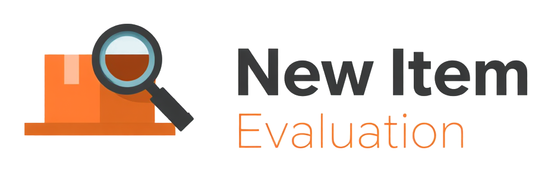
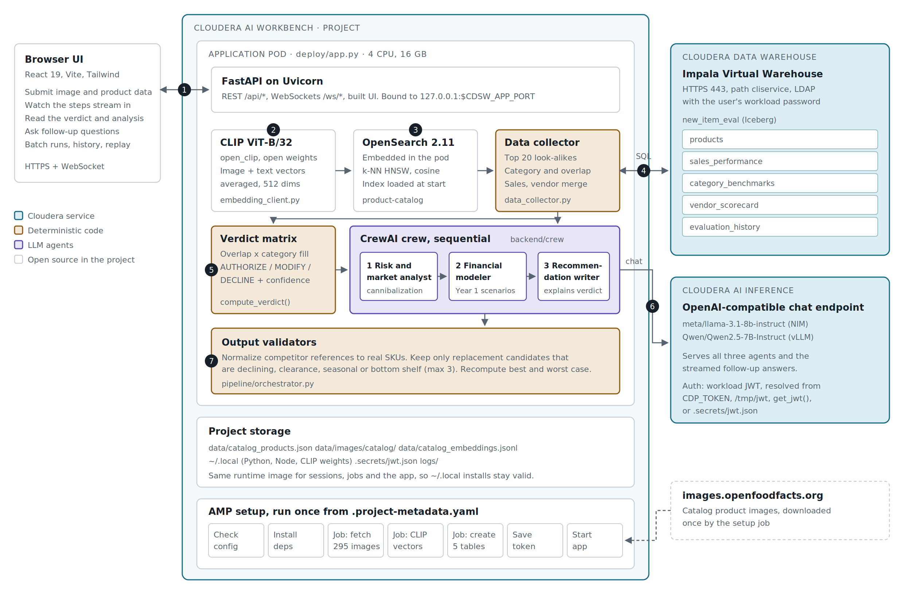

# Cloudera Blueprint: New Item Evaluation Platform

[](LICENSE)
[](backend/requirements.txt)
[](METADATA.yaml)
[]()
[](https://github.com/cloudera-applied-ai/AI_Blueprint_Retail-New-Item-Evaluation/stargazers)
[](https://github.com/cloudera-applied-ai/AI_Blueprint_Retail-New-Item-Evaluation/network/members)

> A sequential **agentic workflow** that evaluates new **CPG / Grocery** product proposals from suppliers against a retailer's existing assortment using **multimodal (image + text) intelligence**. Suppliers submit a new product (images + data); AI agents evaluate it step by step: visual similarity, cannibalization risk, market context, financial projection, and a final recommendation.

<p align="center">
  
</p>

## Table of Contents

- [Overview](#overview)
- [Demo](#demo)
- [Use Case](#use-case)
- [Key Features](#key-features)
- [Quickstart / Guide](#quickstart--guide)
- [Architecture / Software Components](#architecture--software-components)
- [Target Audience](#target-audience)
- [Repository Structure](#repository-structure)
- [Prerequisites](#prerequisites)
- [Hardware Requirements](#hardware-requirements)
- [Documentation](#documentation)
- [API endpoints](#api-endpoints)
- [Verdict matrix](#verdict-matrix)
- [Implementation notes](#implementation-notes)
- [Data and license](#data-and-license)
- [License](#license)

## Overview

A supplier submits a new product (images + data) and AI agents evaluate it step by step: visual similarity analysis, cannibalization risk, market context, financial projection, and a final recommendation.

The core differentiator: **OpenSearch multimodal embeddings** let the agents *see* what products look like, not just read their descriptions.

The platform uses a **hybrid pipeline**: deterministic data collection (CLIP embed, k-NN search, retail metrics from DuckDB or Iceberg via Impala) followed by **agentic reasoning** (CrewAI, sequential). The final **AUTHORIZE / MODIFY / DECLINE** call is **not** chosen by an LLM — it is computed by a decision matrix in `backend/pipeline/orchestrator.py:compute_verdict()`. Agent 3 synthesizes evidence to support the predetermined verdict so decisions stay consistent and auditable.

## Demo



Reference architecture on Cloudera AI. The Application pod in the AI Workbench project runs the API and UI, CLIP and an embedded OpenSearch k-NN index. Sales, category and vendor data come from Iceberg tables through an Impala Virtual Warehouse in Cloudera Data Warehouse, and the three agents run on an open-weight model served by Cloudera AI Inference. Numbers 1 to 7 follow one evaluation: submit, embed, find look-alikes, query Impala, compute the verdict, run the agents, validate and save.

## Use Case

Retail merchants and category managers receive hundreds of **new item proposals** from CPG suppliers. Approving the wrong SKU cannibalizes existing assortment, wastes shelf space, or misses white-space opportunities. Teams need a repeatable way to:

- Compare a proposed product **visually and semantically** to the current catalog.
- Ground recommendations in **sales, category saturation, and vendor history** (not LLM guesswork alone).
- Produce an **auditable verdict** (authorize, modify terms, or decline) with agent-written narrative support.

This blueprint demonstrates that flow on Cloudera: multimodal search on OpenSearch, enterprise data from **Iceberg** via **Impala**, reasoning on **Cloudera AI Inference**, and a **Cloudera AI Workbench Application** for the operator UI.

## Key Features

- **Multimodal look-alike search** — CLIP (ViT-B/32) embeddings + OpenSearch k-NN (HNSW, cosine similarity).
- **Two-phase pipeline** — fast deterministic Phase 1 (2–3s), then sequential CrewAI agents for risk, financials, and synthesis.
- **Deterministic verdict engine** — matrix-driven AUTHORIZE / MODIFY / DECLINE with agent narrative aligned to the computed outcome.
- **Cloudera-native deployment** — AMP via [`.project-metadata.yaml`](.project-metadata.yaml); embedded OpenSearch in the application pod; Impala-backed Iceberg tables in production.
- **Real-time UX** — WebSocket streaming for evaluation progress and follow-up Q&A.
- **Laptop parity** — Docker OpenSearch + DuckDB for local development and smoke tests.

## Quickstart / Guide

### Deploy on Cloudera AI

The platform runs end-to-end on Cloudera: a Cloudera AI Workbench Application serves the app, the agents call an open-weight model on Cloudera AI Inference, OpenSearch runs embedded in the application pod, and the retail tables are Iceberg tables queried through Cloudera Data Warehouse Impala.

**As an AMP (recommended):** in a Workbench choose New Project, Initial Setup: AMPs, paste this repository's URL, then Configure Project. [`.project-metadata.yaml`](.project-metadata.yaml) declares the runtime, the prompted environment variables (`LLM_BASE_URL`, `LLM_MODEL`, `IMPALA_HOST`, optional `CDP_TOKEN`), the bootstrap tasks and the application.

**From a session:**

```bash
python deploy/cml_setup.py --run     # creates jobs + application with cmlapi, starts the bootstrap chain
```

See [DEPLOY_CLOUDERA.md](DEPLOY_CLOUDERA.md) for configuration, the job chain, and how each Cloudera service is used.

### Getting started (laptop)

#### Configure secrets

```bash
cp .env.example .env
# laptop: set LLM_PROVIDER=openai_compatible, LLM_BASE_URL, LLM_MODEL (and LLM_API_KEY if needed),
#         OPENSEARCH_MODE=external, DB_BACKEND=duckdb
```

#### Start OpenSearch

```bash
docker compose up -d
curl http://localhost:9200   # verify
```

#### Backend

```bash
python -m venv venv
source venv/bin/activate
pip install -r backend/requirements.txt
```

#### One-time bootstrap (~10–15 minutes)

Populates the OpenSearch index and seeds DuckDB. Run after `docker compose up -d` and before starting the backend.

```bash
# 1. Download the 295 catalog images referenced by data/catalog_products.json
#    (scripts/download_catalog.py + assign_categories.py rebuild the catalog from scratch instead)
python scripts/fetch_images.py

# 2. Generate CLIP embeddings (cached in data/catalog_embeddings.jsonl) and bulk-load
#    the product-catalog index (created automatically; dim=512, hnsw, cosinesimil)
python scripts/index_catalog.py

# 3. Seed the retail tables (DuckDB here; --backend impala for Iceberg on Cloudera)
python backend/data/init_db.py --backend duckdb
```

Verify the OpenSearch index is populated:

```bash
curl http://localhost:9200/product-catalog/_count
```

#### Run the backend

```bash
cd backend && python -m uvicorn main:app --port 8001
```

#### Frontend

```bash
cd frontend
npm install
npm run dev   # http://localhost:5173, proxies /api and /ws to backend:8001
# or build once (deploy/build_frontend.sh) and let the backend serve frontend/dist itself
```

#### Smoke test

```bash
source venv/bin/activate
python backend/smoke_test.py
```

Exercises the full pipeline end-to-end (3 canonical scenarios + follow-up + replay). Expect 5/5 passing in ~90 seconds.

## Architecture / Software Components

Hybrid pipeline: deterministic data collection + agentic reasoning.

```
User submission (image + name + price + category + claims)
        |
        v
PHASE 1 — Deterministic (2–3s, plain Python, no LLM)
  1. Generate CLIP embedding (ViT-B/32)
  2. OpenSearch k-NN visual similarity search
  3. Gather sales / category / vendor data from DuckDB
        |
        v
PHASE 2 — Agentic reasoning (CrewAI, sequential)
  4. Risk & Market Analyst        -> cannibalization + market timing
  5. Financial Modeler            -> revenue + margin + scenarios
  6. Recommendation Synthesizer   -> AUTHORIZE / MODIFY / DECLINE
        |
        v
Deterministic verdict engine resolves the final call
based on overlap classification + category saturation.
```

### Tech stack

- Python 3.11+, FastAPI, uvicorn
- CrewAI for agent orchestration (sequential)
- Open-weight LLM on Cloudera AI Inference (validated: Llama 3.1 8B Instruct on NIM, Qwen2.5 7B Instruct on vLLM) for agent reasoning via CrewAI; on a laptop any OpenAI-compatible server hosting an open-weight model (`LLM_PROVIDER=openai_compatible`)
- React 19 + TypeScript + Vite 8 + Tailwind v4
- OpenSearch 2.11 with the k-NN plugin (Docker on a laptop; embedded in the Cloudera AI application pod; or any external OpenSearch 2.x cluster)
- Retail tables as Iceberg in the Cloudera Data Lake via Cloudera Data Warehouse Impala (`DB_BACKEND=impala`); DuckDB on a laptop
- CLIP (ViT-B/32 via open-clip-torch) for multimodal embeddings
- WebSocket streaming for real-time UI updates

## Target Audience

- **Retail / CPG solution architects** — reference multimodal assortment evaluation on Cloudera AI, CDW, and AI Inference.
- **ML and data engineers** — OpenSearch k-NN, CLIP serving, Iceberg/Impala integration, and CrewAI orchestration patterns.
- **Category managers and innovation teams** — demo UX for supplier new-item intake with explainable verdicts.
- **Developers extending the blueprint** — swap DuckDB for Impala, plug a different open-weight endpoint, or extend the verdict matrix.

## Repository Structure

```
.
├── .project-metadata.yaml      # AMP definition (runtime, env vars, bootstrap tasks, application)
├── docker-compose.yml          # OpenSearch container (laptop)
├── .env.example                # Template for required env vars
├── DEPLOY_CLOUDERA.md          # Cloudera AI deployment guide
├── deploy/
│   ├── app.py                  # Cloudera AI Application entry (embedded OpenSearch + API + UI)
│   ├── cml_setup.py            # Creates the Workbench jobs + application via cmlapi
│   ├── install_deps.py         # Job 01: pip / CLIP weights / OpenSearch bundle / frontend build
│   ├── bootstrap_embed.py      # Job 03: CLIP embeddings cache (+ remote OpenSearch load)
│   ├── check_endpoints.py      # Connectivity checks for AI Inference, OpenSearch, Impala
│   ├── build_frontend.sh       # Node install + npm build without a system Node
│   └── opensearch/embedded.py  # OpenSearch running inside a Cloudera AI pod
├── backend/
│   ├── main.py                 # FastAPI app + WebSocket endpoints (port 8001)
│   ├── smoke_test.py
│   ├── requirements.txt
│   ├── pipeline/
│   │   ├── data_collector.py   # Deterministic Phase 1
│   │   ├── orchestrator.py     # Runs collector + crew + verdict engine
│   │   └── followup.py         # Post-verdict Q&A streaming
│   ├── crew/
│   │   ├── agents.py           # 3 CrewAI agents (no tools)
│   │   ├── tasks.py            # Task builders with REASONING: field
│   │   └── crew.py             # Sequential crew wiring
│   ├── tools/
│   │   ├── llm_config.py       # Cloudera AI Inference / OpenAI-compatible provider resolution
│   │   ├── opensearch_conn.py  # OpenSearch URL / auth / TLS (embedded, external cluster, docker)
│   │   ├── opensearch_client.py
│   │   ├── embedding_client.py
│   │   ├── db.py               # DuckDB or Impala (Iceberg) query backend
│   │   └── database_client.py
│   └── data/
│       └── init_db.py          # Seed retail tables (DuckDB or Iceberg via Impala)
├── frontend/                   # React + Vite + Tailwind v4
└── data/
    ├── catalog_products.json   # Catalog metadata (consumed by init_db.py)
    └── images/test/            # Three test images used by backend/smoke_test.py
```

| Path | Description |
| --- | --- |
| `METADATA.yaml` | Cloudera blueprint catalog metadata |
| `images/reference-architecture.png` | Cloudera deployment reference diagram |
| `scripts/` | Catalog image fetch, CLIP indexing, category assignment |
| `LICENSE` | Apache 2.0 (application code) |

## Prerequisites

**Cloudera platform (production path)**

- Cloudera AI Workbench with Application support.
- **Cloudera AI Inference** — running OpenAI-compatible chat endpoint (`LLM_BASE_URL`, `LLM_MODEL`).
- **Cloudera Data Warehouse** — Impala Virtual Warehouse reachable from the project (`IMPALA_HOST`, `DB_BACKEND=impala`).
- Optional: CDP token for authenticated Impala (`CDP_TOKEN`).

**Laptop / lab**

- Docker Desktop (for OpenSearch)
- Python 3.10+ (3.11+ recommended; see tech stack)
- Node.js 22.12+ (Vite 8)
- An OpenAI-compatible server hosting an open-weight instruct model (vLLM, Ollama or a NIM container), or a reachable Cloudera AI Inference endpoint

Copy [`.env.example`](.env.example) to `.env` and set provider, OpenSearch mode, and database backend before bootstrap.

## Hardware Requirements

| Deployment | Minimum |
| --- | --- |
| Laptop demo (DuckDB + Docker OpenSearch) | 8 GB RAM, 4 CPU cores, ~10 GB disk for catalog images, embeddings cache, and OpenSearch data |
| Cloudera AI Application (embedded OpenSearch + API + UI) | Size per Workbench/Application quota; CLIP inference and k-NN search are CPU-heavy during bootstrap |
| Cloudera AI Inference | GPU-backed endpoint recommended for agent latency at scale (validated on 7B–8B instruct models) |
| Iceberg / Impala | Virtual Warehouse sized for analytic queries over seeded retail tables |

Bootstrap (image download + CLIP indexing) is the longest one-time step (~10–15 minutes on a typical laptop).

## Documentation

- [DEPLOY_CLOUDERA.md](DEPLOY_CLOUDERA.md) — Cloudera AI configuration, job chain, and service wiring
- [`.project-metadata.yaml`](.project-metadata.yaml) — AMP runtime, environment variables, and bootstrap tasks

## API endpoints

```
POST   /api/evaluate                          # Submit product -> { evaluation_id }
WS     /ws/evaluation/{evaluation_id}         # Stream pipeline progress

POST   /api/evaluate/followup/{evaluation_id} # { question } -> { followup_id }
WS     /ws/followup/{followup_id}             # Stream answer chunks

GET    /api/evaluations/latest                # Replay last run
GET    /api/evaluations                       # History
GET    /api/evaluations/stats                 # Aggregate stats
POST   /api/evaluate/batch                    # Batch evaluation
WS     /ws/batch/{batch_id}                   # Batch progress
GET    /api/products/{sku}                    # Product details
GET    /api/catalog/summary                   # Category counts
GET    /api/catalog/products                  # Full catalog listing
GET    /api/images/{filename}                 # Static product images
GET    /api/health                            # OpenSearch / Impala / LLM / frontend status
```

## Verdict matrix

|                              | Category Full (≥15 SKUs) | Category Has Room (<15 SKUs) |
|------------------------------|--------------------------|------------------------------|
| **High Overlap (>0.88)**     | DECLINE (90%)            | MODIFY (75%)                 |
| **Moderate (0.82–0.88)**     | MODIFY (72%)             | AUTHORIZE (80%)              |
| **White Space (<0.82)**      | AUTHORIZE (85%)          | AUTHORIZE (85%)              |
| **New Category**             | AUTHORIZE (82%)          | AUTHORIZE (82%)              |

Computed in `backend/pipeline/orchestrator.py:compute_verdict()`.

## Implementation notes

- Revenue in DuckDB is computed as `weekly_units * price * 52 * noise_factor` (0.85–1.15) so price / velocity / revenue stay internally consistent.
- Agent 2's financial projections are post-processed to enforce Best = Expected × 1.20 and Worst = Expected × 0.70, preventing identical scenario values.
- Auto-detect category uses similarity-weighted voting across cross-category top-20 results. Threshold `MIN_CATEGORY_SIMILARITY = 0.86` — below that the product is classified as **New Category**.
- CrewAI agents receive the pre-collected DataPackage as task context. They do **not** call tools, eliminating tool-call latency and failure modes.

## Data and license

The catalog is 295 snack products from [Open Food Facts](https://world.openfoodfacts.org). Product metadata in `data/catalog_products.json` is available under the Open Database License (ODbL); product images are downloaded at bootstrap from images.openfoodfacts.org and are under CC BY-SA, so they are not committed here. Sales, margin, vendor and benchmark figures are synthetic (`backend/data/init_db.py`, fixed seed) and describe no real retailer.

## License

Code is licensed under the Apache License 2.0, see [LICENSE](LICENSE).
